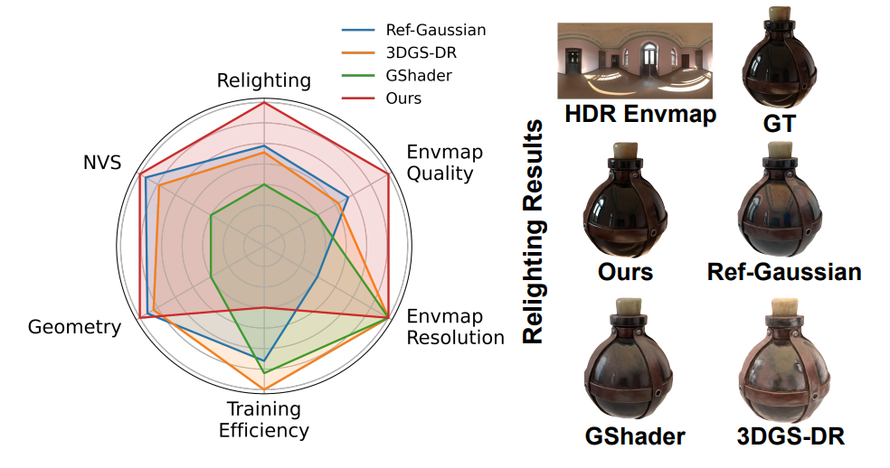
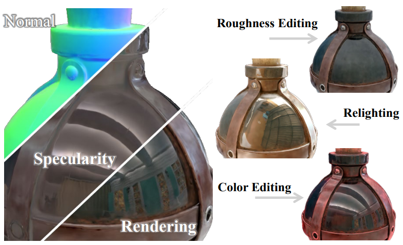
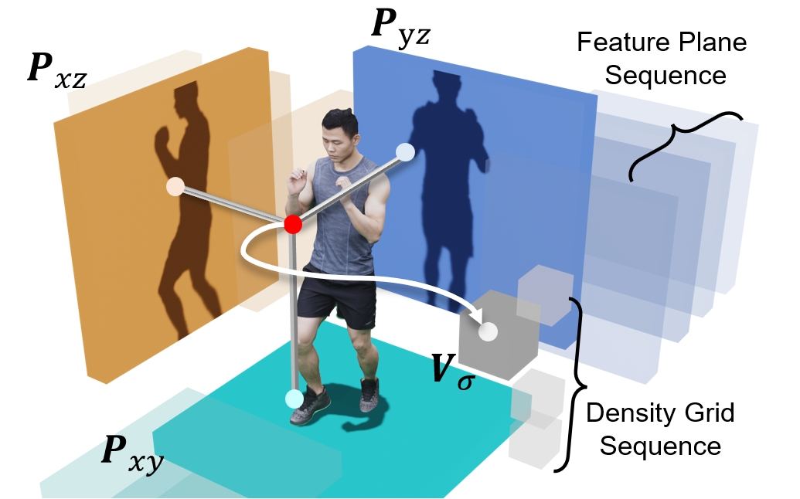
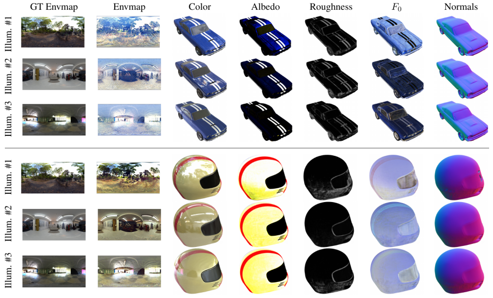
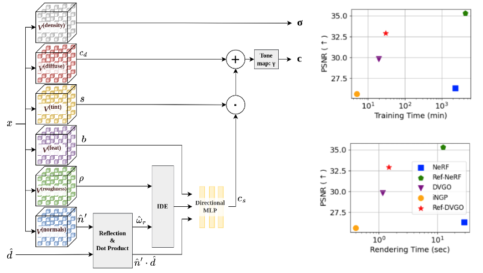
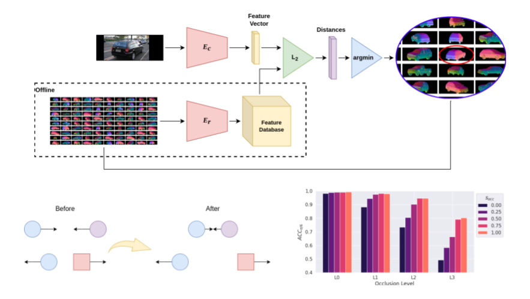

I am a postdoctoral researcher at the [Artificial Intelligence and Translational Imaging (ATI) Lab](https://www.atilab.net/), [School of Medicine](https://med.uoc.gr/en/medschool-en/), [University of Crete](https://www.uoc.gr/), working under the supervision of [Prof. Michail Klontzas](https://scholar.google.com/citations?user=uWQOxUkAAAAJ&hl=en) and in collaboration with [Dr. Eleftherios Tzanis](https://scholar.google.com/citations?user=nkMCS88AAAAJ&hl=en). My research focuses on agentic AI for medical imaging, exploring how language models and multi-agent systems can integrate medical imaging tools to support clinical workflows, with an emphasis on reliability, interpretability, and patient privacy.

I completed my PhD at the PSI Lab at KU Leuven, Belgium, supervised by [Prof. Tinne Tuytelaars](https://scholar.google.com/citations?user=EuFF9kUAAAAJ&hl=en) and [Dr. Minye Wu](https://scholar.google.com/citations?user=aUAnceQAAAAJ&hl=en). My doctoral research focused on neural rendering and inverse graphics, with an emphasis on physically grounded reconstruction of glossy and specular materials.

Before my PhD, I worked as an Industry 4.0 consultant at [Kapernikov](https://kapernikov.com/) in Brussels and as a research assistant at [ITI](https://www.iti.gr/iti/en/home/)-[CERTH](https://www.certh.gr/root.en.aspx) in Thessaloniki, contributing to the [Horizon 2020 BADGER project](https://www.badger-robotics.eu/) on autonomous robotic systems for subsurface exploration. Earlier, I worked on autonomous search-and-rescue robotics with the [Pandora Robotics Team](https://issel.ee.auth.gr/pandora-robotics/) at Aristotle University of Thessaloniki. I hold a Diploma (integrated Bachelor’s and Master’s) in Electrical and Computer Engineering from Aristotle University of Thessaloniki and an Advanced Master of Artificial Intelligence from KU Leuven.

Projects
========

  <a href="https://gkouros.github.io/projects/SpecGloss-GS/" class="ns-project-link">
    

        
        

            
Spec-Gloss Surfels and Normal-Diffuse Priors for Relightable Glossy Objects

            
SpecGloss-GS effectively decouples geometry, materials, and illumination for more accurate relighting and scene editing of glossy objects.

            
Georgios Kouros, Minye Wu, Tinne Tuytelaars

            
WACV 2026 (oral)

        

    

  </a>

  <a href="https://gkouros.github.io/projects/RGS-DR/" class="ns-project-link">
    

        
        

            
RGS-DR: Deferred Reflections and Residual Shading in 2D Gaussian Splatting

            
RGS-DR uses 2DGS with deferred shading, split-sum IBL plus an image-space residual to sharpen speculars and enable relighting and scene editing.

            
Georgios Kouros, Minye Wu, Tinne Tuytelaars

            
3DV 2026

        

    

  </a>

  <a href="https://wuminye.github.io/projects/TeTriRF/" class="ns-project-link">
    

        
        

            
TeTriRF: Temporal Tri-Plane Radiance Fields for Efficient Free-Viewpoint Video

            
TeTriRF compresses free-viewpoint dynamic scenes by codec-friendly tri-plane voxel representations.

            
Minye Wu, Zehao Wang, Georgios Kouros, Tinne Tuytelaars

            
CVPR 2024

        

    

  </a>

  <a href="https://openaccess.thecvf.com/content/CVPR2024W/NRI/html/Kouros_Unveiling_the_Ambiguity_in_Neural_Inverse_Rendering_A_Parameter_Compensation_CVPRW_2024_paper.html" class="ns-project-link">
    

        
        

            
Unveiling the Ambiguity in Neural Inverse Rendering: A Parameter Compensation Analysis

            
A study of the inherent ambiguity of neural inverse rendering and potential research directions.

            
Georgios Kouros, Minye Wu, Sushruth Nagesh, Xianling Zhang, Tinne Tuytelaars

            
CVPR 2024 NRI Workshop

        

    

  </a>

  <a href="https://arxiv.org/abs/2308.08530" class="ns-project-link">
    

        
        

            
Ref-DVGO: Reflection-Aware Direct Voxel Grid Optimization for an Improved Quality-Efficiency Trade-Off in Reflective Scene Reconstruction

            
Improves the quality-efficiency trade-off for neural rendering of glossy objects by combining an efficient voxelized representation with a reflection direction reparameterization.

            
Georgios Kouros, Minye Wu, Shubham Shrivastava, Sushruth Nagesh, Punarjay Chakravarty, Tinne Tuytelaars

            
ICCV 2023 TRICKY Workshop

        

    

  </a>

  <a href="https://bmvc2022.mpi-inf.mpg.de/26/" class="ns-project-link">
    

        
        

            
Category-Level Pose Retrieval with Contrastive Features Learnt with Occlusion Augmentation

            
Category-level pose estimation trained with contrastive RGB-normal features and augmented with occlusion and bounding box augmentation for robustness against occluders and bounding box noise.

            
Georgios Kouros, Shubham Shrivastava, Cédric Picron, Sushruth Nagesh, Punarjay Chakravarty, Tinne Tuytelaars

            
BMVC 2022

        

    

  </a>

A full list of my publications can be found in my [google scholar profile](https://scholar.google.com/citations?user=kEZX1y8AAAAJ&hl=en).

<!-- Default Statcounter code for homepage https://wuminye.github.io/ -->

<noscript>

</noscript>
<!-- End of Statcounter Code -->

